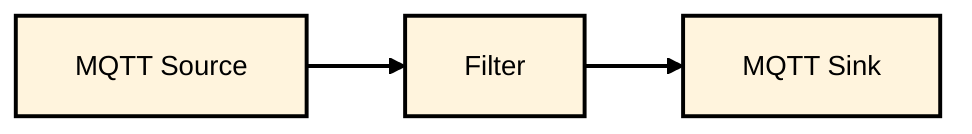
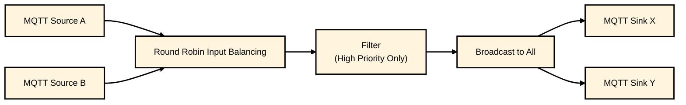

# Pyrophone Architectural Overview

## Overview

Pyrophone is a Python-based dataflow nodal data processing framework. It is primarily intended for the processing of streaming data or messages in network environments.

Nodes originate, receive, or both receive and output data.

## Example Use Case

For example, suppose you wish to process messages originating from an MQTT topic, filter and transform them, and publish them to another MQTT topic:



Graphs can be constructed to facilitate arbitrarily complex processing schemes:



## Computation Model

Pyrophone graphs are comprised of nodes and channels. Nodes represent active agents which can execute autonomously and concurrently relative to any other node, which have a characterised set of input and output ports, which may have private state, and which can produce output either in response to input or independently of any stimulus.

Pyrophone is roughly an implementation of the Flow-Based Programming (FBP) model originally proposed by J. Paul Rodker Morrison. It is similar to the Actor model in that each node represents an active agent which can act autonomously and concurrently, but unlike the Actor model, a node is characterised as having multiple input and output ports rather than a single receptor of incoming messages.

Nodes are either fundamental or composite nodes. A composite node is a node which has an internal implementation which is itself a Pyrophone graph. This enables complex functionality to be composed in a GUI environment and aggregated into composite nodes and reused. There is no limit on the nesting of composite nodes, and each instantiation of a composite node is independent.

Channels represent the edges between nodes. Like nodes, channels are either fundamental or composite. A composite channel comprises one or more subchannels, which themselves are either fundamental or composite.

A fundamental channel is a unidirectional pipe which can transport bytes, frames (i.e., sequences of zero or more bytes) or other Python objects. In the current design, a fundamental channel has its input side connected to exactly one port and its output side connected to exactly one port.

Nodes can take action independently of stimulus, for example in response to an external event or due to the passage of time. They may have private state, and might even choose to persist private state in a durable store to allow graphs to be saved and restored and thereby maintain persistence of their current computational state across Pyrophone process lifetimes.

The distribution of a Pyrophone graph over multiple compute nodes is envisaged as a potential future capacity, but not modelled at this time. Such functionality naturally restricts channel usage to Python objects which are serializable.

Custom fundamental nodes can be implemented by users, for example to implement new sources, sinks, filters, or other kinds of nodes.

## High Level v. Low Level Representation

There are many cases where a graph as might be most naturally conveyed by a user can be expressed in terms of a more complex graph made up of simpler node types.

For example:

- **Buffered channels.** A fundamental channel with some finite buffer capacity can be modelled as a node and an unbuffered fundamental channel. The private state of the node is an in-memory deque used to store the current channel buffer contents.

-
  **Acknowledgement processing.** Consider the following naive processing graph:
  
  ```mermaid
  ---
  config:
    theme: base
    themeVariables:
      strokeWidth: 2
      fontSize: 14px
      fontFamily: Helvetica
      nodeBorder: "#000"
      primaryTextColor: "#000"
      lineColor: "#000"
  ---
  flowchart LR
    AMQPSource[AMQP Source] --> Transform
    Transform --> SMTPSink[SMTP Sink]
  ```
  
  In this scenario, emails for transmission arrive on an AMQP message queue, must be transformed slightly, and must then be sent onwards using an SMTP server.

  Each email must be processed in a reliable way that can survive worker failure during processing of a given message, with at-least-once delivery semantics.

  The AMQP protocol can be used to acknowledge a work item (such as an email) once it has been successfully processed, such that failure to process it will result in it being automatically requeued for another worker.
  
  Therefore, while this graph is shown as a simple unidirectional flow, it actually contains an implicit backwards flow: a message obtained from the AMQP Source must result in a backwards acknowledgement indication to the AMQP Source server once (and only once) the SMTP Sink acknowledges durable acceptance of the message (i.e., SMTP `DATA` accepted with a success code).

  Requiring users to manually configure and explicitly design backwards acknowledgement channels significantly complicates the design of processing graphs and is best kept implicit at the user's graph design level.

The solution chosen here is to distinguish between a high-level graph expressing user intent and a low-level graph which is automatically elaborated from that high-level graph and which is expressed solely in terms of fundamental constructs. Users can dive into and view the low-level graph if they wish, but will generally not need to.

For example, when a user configures the naive processing graph shown above, the channels shown are actually composite channels comprising both a forward fundamental channel containing message data and a backwards fundamental channel to transport acknowledgement notifications, bonded together with request/reply semantics. These two subchannels appear in the high-level representation as a single channel.

## Live Modification

Pyrophone allows for live modification of a graph and is designed to minimize disruption during such a change. This means, for example, that defining and running a graph in a graphical editor must allow changes to be made without flushing the private data of nodes (or internally auto-elaborated nodes) which are common to both the prior and subsequent versions of a graph.

## Use of Python

Pyrophone is implemented in Python 3 and uses a fully asynchronous, asyncio-based architecture. There are several ways to compose graphs:

- **Procedural builder.** A fluent-style API which is used to compose a high-level graph. The graph is compiled into a low-level graph and instantiated by Pyrophone. The graph is expressed as a single (potentially very concise) Python file, enabling Pyrophone to be used as a DSL for message processing flows.

- **Graphical builder.** A graphical node-based programming environment that enables graphs to be defined in a visual environment. A graph definition is saved and persisted using the serialized representation.

- **Serialized representation.** A machine-readable file which defines a graph, as a set of nodes and channels and their assembly. This is a serialization of the in-memory representation produced by either the procedural or graphical builder approaches. It differs from DSL-style use because it expresses a graph in a non-Turing-complete syntax which can be read and written automatically.

## Easy Node Type Definition

Pyrophone allows new fundamental node types to be defined in Python in an
ergonomic and intuitive way as simple Python class definitions.

For example, this is a definition of a simple node type which takes an integer
$x$ as input, and produces another integer by adding a configurable constant:

```python
class Add(Transform[int, int]):
	amount = Property[int](
		default=1,
		title="Amount",
		description="The amount added to each incoming value.",
	)
	
	async def transform(self, value: int) -> int:
		return value + self.amount
```

Because this node type is a simple transform, it is defined using the built in
`Transform` helper, which reduces boilerplate for simple transformation nodes.
We can see a more elaborate example of a node definition by looking at the
definition for `Transform`:

```python
class Transform[InputT, OutputT](Node):
	in_port = Input[InputT](description="Receives values to transform")
	out_port = Output[OutputT](description="Outputs transfortmed values")

	async def run(self) -> None:
		async for value in self.in_port:
			result = await self.transform(value)
			await self.out_port.send(result)
	
	async def transform(self, value: InputT) -> OutputT:
		raise NotImplementedError("Transform subclass must implement transform()")
```

This shows how abstract node types can be defined to be used as bases for more
specialized node types, minimizing the lines of code needed to implement custom
functionality in Python.

If a user needs to define a new fundamental node type, they need merely write
`class Foo(Node):`, define properties, define inputs and outputs (which are
technically kinds of properties), and define `async def run(self)`.
