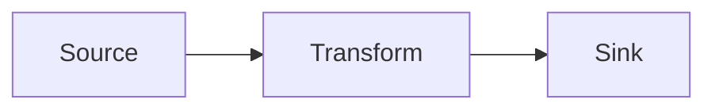

Pyrophone is a dataflow-oriented data processing framework implemented in Python 3. It provides a [dataflow programming](https://en.wikipedia.org/wiki/Dataflow_programming) environment.

## Introduction to dataflow programming

In dataflow programming, a program is expressed as a *graph* of processing nodes.

:::note
“Graph” here is meant in the sense of [graph theory](https://en.wikipedia.org/wiki/Graph_theory), meaning a set of **nodes**, and a set of **edges** connecting them. “Edges” is the term used by graph theory; think of them as links or lines between nodes.
:::

Each node represents a computational process which can receive and emit information via defined connections to other nodes. Some nodes are able to receive or send information to or from external sources, while others may be characterised solely in terms of their inputs and outputs.

You can think of dataflow programming as comparable to computer networking, where data is transmitted over communications channels between independently executing computational processes.

## Pyrophone's model

Pyrophone is a framework for defining **graphs** which comprise **nodes** and **channels** linking them. Channels are what Pyrophone calls edges.

**Nodes.** In Pyrophone's model, nodes represent **active agents** which

- can execute **autonomously and concurrently** relative to any other node;
- have a characterised set of input and output **ports**;
- **may** have private state; and
- can produce output either in response to input or independently of any external stimulus (for example, due to time passing or other external factors).

Pyrophone is roughly an implementation of the [Flow-Based Programming](https://en.wikipedia.org/wiki/Flow-based_programming) model, a form of dataflow programming.

**Properties.** Pyrophone nodes define **properties**, which are variables used to configure nodes. They serve as the input values provided to a node when it is instantiated.

**Ports.** Ports are a kind of property which can be connected to a **channel**. A port is either an input port, which can be connected to the output end of a channel, or output port, which can be connected to the input end of a channel.

**Channels.** A channel represents a connection between two ports of two respective nodes, and transports data between those nodes. A channel is similar to e.g. a TCP connection, but it can transport arbitrary Python objects, as well as ordinary bytestring or Unicode string data. A specific channel is designed (i.e., typed) to accept a specific kind of data.

:::note
Pyrophone's processing model is similar to the Actor model, which is more well-known than Flow-Based Programming (FBP), but differs in some ways. It is comparable to the Actor model because nodes represent independently and concurrently executing processes which are active agents, but differs in that a node can have multiple distinct channels for receiving information (ports).
:::

## Node Execution

Pyrophone is a fully asyncio-native runtime. A Pyrophone node's active execution is modelled as a long-running `async` function. 

## Lifecycle

The Pyrophone program lifecycle runs in several stages:

- **High-level graph assembly.** The user's program runs and, in some arbitrary way, composes a high-level graph representation (for example by instantiating nodes and using the pipe operator). It returns this graph representation to the Pyrophone runtime.

  If a graph is being loaded from a machine-readable serialization (e.g. a Pyrophone YAML serialization of a graph), this step is skipped.

- **Pyrophone runtime startup.** The Pyrophone runtime provides in-the-box CLI processing, configures itself, and examines the high-level graph that has been programmatically constructed.

- **Compilation.** The high-level graph is compiled to a low-level graph representation.

- **Execution.** The low-level graph is executed by the Pyrophone runtime.